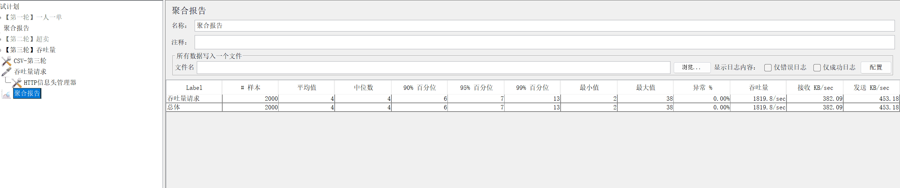
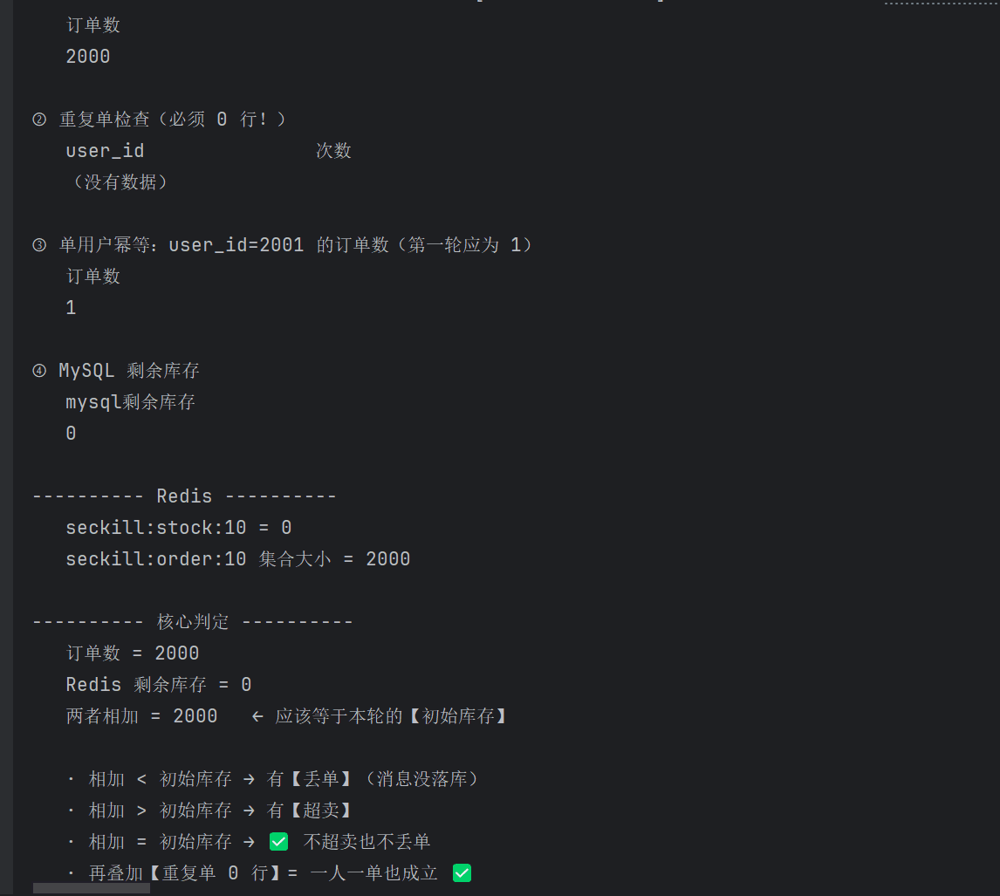

# Redis 点评 · 本地生活服务平台

基于 Redis 的本地生活服务平台后端，包含商户浏览、探店笔记、关注与点赞、优惠券秒杀等业务。

核心特点：**Redis 用得很重** —— 缓存、分布式锁、秒杀、登录态、点赞排行、附近商户都用到了。在完成基础业务后，围绕**缓存一致性、并发控制、消息可靠性**做了几轮改造，每项都有实测数据。

---

## 技术栈

| 分类 | 技术 |
|---|---|
| 框架 | Spring Boot 2.3.12、Spring MVC、Spring AOP |
| 持久层 | MyBatis-Plus 3.4.3、MySQL |
| 缓存 | Redis（Spring Data Redis + Lettuce 连接池） |
| 分布式锁 | Redisson 3.13.6 + 自研 SimpleRedisLock（Lua 脚本解锁） |
| 消息队列 | RabbitMQ（Spring AMQP） |
| 其他 | Hutool、Lombok |

**代码规模**：75 个 Java 文件，约 3400 行

---

## 项目结构

```
hm-dianping
├── config        MvcConfig / MybatisConfig / RedissonConfig / MqConfig / MqConfirmConfig
├── controller    9 个接口入口
├── dto           请求参数对象
├── entity        10 个实体（Shop / Blog / Voucher / VoucherOrder ...）
├── mapper        MyBatis-Plus Mapper
├── mq            VoucherOrderMQListener（秒杀订单消费者）
├── service       20 个业务类
└── utils         CacheClient / SimpleRedisLock / RedisIdWorker / 登录拦截器 ...
```

---

## Redis 都用在哪

| 场景 | 数据结构 | Key |
|---|---|---|
| 登录态 | Hash | `login:token:{token}`（TTL 10 小时） |
| 商户缓存 | String | `cache:shop:{id}`（TTL 30 分钟） |
| 缓存空值（防穿透） | String | `cache:shop:{id}` = `""`（TTL 2 分钟） |
| 缓存重建互斥锁 | String | `lock:shop:{id}`（TTL 10 秒） |
| 秒杀库存 | String | `seckill:stock:{券id}` |
| 秒杀已购用户 | Set | `seckill:order:{券id}` |
| 点赞 / 收藏 | Sorted Set | `blog:liked:{blogId}`（score = 时间戳） |
| 关注 / 共同关注 | Set | `follow:{userId}`，用 SINTER 求交集 |
| 签到 | Bitmap | `sign:{userId}:{yyyyMM}`（第 N 天占第 N-1 位） |
| 附近商户 | GEO | `shop:geo:{typeId}`，GEOSEARCH 按距离排序 |
| 全局唯一 ID | Redis 自增 | `icr:{业务前缀}:{yyyy:MM:dd}` |

---

## 核心实现

### 一、缓存：穿透 / 击穿 / 雪崩

**缓存穿透**（查不存在的数据，请求全打到 DB）

用**空值缓存**兜住：查询结果为空时也写进 Redis，值为空串，TTL 设短（2 分钟）。

```java
// CacheClient.queryWithPassThrough
String json = stringRedisTemplate.opsForValue().get(key);
if (StrUtil.isNotBlank(json)) {
    return JSONUtil.toBean(json, type);   // 命中
}
if (json != null) {
    return null;                          // 命中的是空串 → 之前查过，不存在
}
// 未命中 → 查库 → 写缓存（空值也写，TTL 短）
```

**缓存击穿**（热点 key 过期的瞬间，大量请求同时打到 DB）

实现了两种方案，代码都保留，可切换：

| 方案 | 思路 | 代价 |
|---|---|---|
| **互斥锁** | 只让一个线程去重建缓存，其他线程等待重试 | 会阻塞，吞吐低 |
| **逻辑过期** | 缓存不设 TTL，值里带过期时间；发现过期就把重建任务丢给线程池，当前请求先返回旧数据 | 可能短暂读到旧数据 |

**缓存雪崩**：给 TTL 加随机值，避免同一时刻大批 key 同时过期。

---

### 二、分布式锁

**自研 SimpleRedisLock**：

- 加锁：`SETNX key threadId` + 过期时间，防止死锁
- 解锁：用 **Lua 脚本**保证"判断是不是自己 + 删除"的原子性

```lua
-- unlock.lua
if (redis.call('get', KEYS[1]) == ARGV[1]) then
    return redis.call('del', KEYS[1])
end
return 0
```

**为什么不直接 DEL**：如果线程 A 的锁超时自动释放了，线程 B 拿到锁，这时 A 执行 DEL 会把 B 的锁删掉。Lua 脚本让"比对 + 删除"在同一原子操作里完成。

**Redisson**：项目里也引入了 Redisson，用于可重入锁、锁续期等更复杂的场景。

---

### 三、秒杀：Redis + Lua 原子判断

**问题**：秒杀下单要判断"库存够不够"和"这个用户是不是买过"，两条命令分别执行会有并发窗口 —— 超卖、一人多单。

**方案**：把判断和扣减全放进 Lua 脚本，Redis 单线程执行，天然原子。

```lua
-- seckill.lua
-- 1. 库存不足 → 返回 1
if (tonumber(redis.call('get', stockKey)) <= 0) then return 1 end
-- 2. 重复下单 → 返回 2
if (redis.call('sismember', orderKey, userId) == 1) then return 2 end
-- 3. 扣库存 + 记录用户 → 返回 0
redis.call('incrby', stockKey, -1)
redis.call('sadd', orderKey, userId)
return 0
```

**接口流程**：

```
秒杀请求
   │
   ├─ Lua 脚本判断资格（库存 + 一人一单）
   │     不通过 → 直接返回"库存不足"或"请勿重复下单"
   │
   ├─ 通过 → 生成订单号 → 发消息到 RabbitMQ
   │
   └─ 立刻返回订单号（不等落库）
          │
          ▼
    消费者异步：查库（一人一单兜底）→ 扣库存 → 写订单
          │
          ├─ 成功 → basicAck
          └─ 异常 → basicReject → 死信队列
```

**两层幂等保证**：
1. Lua 里的 `sismember`（Redis 层，快速拦截）
2. 消费者里的 `count` 查询（数据库层，最终兜底）

---

### 四、秒杀下单：内存队列 → RabbitMQ

**改造前**：下单任务放进 JVM 的内存阻塞队列（`ArrayBlockingQueue`），单线程消费落库。

**问题**：
- 消息在 JVM 堆里，**应用重启全丢**
- 看不见、摸不着，出问题没法排查
- 单线程挂了，后面消息全不落库

**改造后**：换成 RabbitMQ（持久化队列 + 手动 ACK + 死信队列）。

| 对比项 | 内存队列 | RabbitMQ |
|---|---|---|
| 应用重启 | 消息全丢 | 消息还在（durable + 持久化） |
| 可观测性 | 看不到 | 管理界面能看到 Ready / Unacked |
| 消费异常 | 线程死了后续全不落库 | 容器管理，失败进死信队列 |
| 消息量上限 | 受 JVM 堆限制 | Broker 侧缓冲 |

**验证**（都截图留证）：

| 场景 | 结果 |
|---|---|
| 正常链路 | 订单落库成功 + 手动 ACK，队列归零 |
| 消费者下线 | 消息堆在 Broker（`order.queue` Ready=1），不在内存 |
| **RabbitMQ 重启** | 消息依然在，消费者上线后正常处理 |
| 消费异常 | `basicReject(false)` → 进 `order.dlx.queue` |

---

### 五、生产端确认（Publisher Confirm）

**问题**：前三层可靠性只保证"Broker 存得住 + 消费端 ACK"，但**生产者发出消息后完全不知道结果** —— 到没到交换机、路由有没有失败，全无感知。如果消息丢了，只能看到"用户拿到订单号但订单永远不落库"，无从排查。

**改造**：

```java
// 给 RabbitTemplate 挂两个回调（不覆盖 Boot 的默认配置）
rabbitTemplate.setMandatory(true);

// ① 消息到没到交换机
rabbitTemplate.setConfirmCallback((correlationData, ack, cause) -> {
    String id = (correlationData != null) ? correlationData.getId() : "无";
    if (ack) {
        log.info("消息已确认送达交换机：id={}", id);
    } else {
        log.error("消息确认失败：id={}, 原因={}", id, cause);
    }
});

// ② 到了交换机但路由不到队列
rabbitTemplate.setReturnCallback((message, replyCode, replyText, exchange, routingKey) ->
        log.error("消息无法路由到队列：exchange={}, routingKey={}", exchange, routingKey));
```

**发送时带上消息 ID**，回调里能对上具体是哪一单：

```java
CorrelationData correlationData = new CorrelationData("seckill:" + orderId);
rabbitTemplate.convertAndSend(exchange, routingKey, voucherOrder, correlationData);
```

**配置**：

```yaml
spring:
  rabbitmq:
    publisher-confirm-type: correlated   # 异步回调，不阻塞发送
    publisher-returns: true
```

**为什么选 `correlated` 不用 `simple`**：`simple` 要同步调 `waitForConfirms()`，每条消息等一个 RTT；`correlated` 是异步回调，发送不阻塞。

**消息不丢的三层保障**（现在是完整的）：

| 环节 | 机制 |
|---|---|
| 生产端 → Broker | publisher confirm + ReturnCallback |
| Broker 存储 | 队列 durable + 消息持久化 |
| 消费端处理 | 手动 ACK，失败进死信 |

---

## 压测数据

**环境**：JMeter 5.6.3，本机 Windows + 虚拟机 Redis，压测前关闭所有后台程序。

**秒杀接口**（券 id=10，2000 并发请求，库存 2000，消费者在线）：

| 指标 | 结果 |
|---|---|
| **吞吐量** | **1819.8 /s** |
| 平均响应 | 4ms |
| 中位数 | 4ms |
| p90 / p95 | 6ms / 7ms |
| **p99** | **13ms** |
| 最大值 | 38ms |
| 异常率 | 0.00% |

**业务正确性**（2000 请求全部完成后校验）：

| 校验项 | 结果 |
|---|---|
| 数据库订单数 | 2000 |
| MySQL 剩余库存 | 0 |
| Redis 剩余库存 | 0 |
| 已购集合大小 | 2000 |
| **订单数 + 剩余库存** | **2000 = 初始库存** ✅ 零超卖、零丢单 |
| 重复单（GROUP BY HAVING > 1） | 0 行 ✅ 一人一单 |
| 单用户幂等（user_id=2001） | 1 单 ✅ |

**另外两轮压测**（同一套接口，不同场景）：

| 轮次 | 场景 | 库存 | 结果 |
|---|---|---|---|
| 第一轮 | 一人一单：同一用户并发狂点 200 次 | 300 | 订单数 1，重复单 0 行 |
| 第二轮 | 防超卖：500 个不同用户同时抢 | 300 | 订单数 300，Redis 余 0，零超卖 |
| 第三轮 | 吞吐量：2000 请求全部成功 | 2000 | 见上表 |

**判定方法**：`订单数 + Redis 剩余库存 = 初始库存`。小于说明丢单（消息没落库），大于说明超卖。同时单独查 `GROUP BY user_id HAVING COUNT(*) > 1` 验证一人一单。

**证据截图**（JMeter 聚合报告：2000 样本，吞吐 1819.8/s，平均 4ms，p99 13ms，异常率 0%）



**证据截图**（压测跑完后的数据校验：订单数 2000、重复单 0 行、MySQL 与 Redis 库存均为 0、两者相加等于 2000）



---

## 快速开始

### 环境要求

| 组件 | 版本 |
|---|---|
| JDK | 8+ |
| Maven | 3.6+ |
| MySQL | 5.7 / 8.0 |
| Redis | 5.0+ |
| RabbitMQ | 3.8+ |

### 启动步骤

```bash
# 1. 建库并导入数据（SQL 在 src/main/resources/db/hmdp.sql）
mysql -uroot -p -e "CREATE DATABASE hmdp DEFAULT CHARSET utf8mb4;"
mysql -uroot -p hmdp < src/main/resources/db/hmdp.sql

# 2. 修改配置
#    编辑 src/main/resources/application.yaml
#    填写你自己的 MySQL 密码、Redis 地址和密码

# 3. 启动 Redis 和 RabbitMQ

# 4. 启动应用
mvn spring-boot:run
# 或者 IDEA 里运行 HmDianPingApplication
```

### 访问地址

```
http://localhost:8081
```

**⚠️ 这是一个纯后端项目，没有前端页面。** 接口用 Postman / Apifox 调用。

### 关于登录

项目用 Redis 模拟登录态，测试时可以直接往 Redis 里塞一个 token：

```bash
HSET login:token:testuser id 1 nickName tester icon ""
EXPIRE login:token:testuser 3600
```

请求时带上 header：`authorization: testuser`

---

## 核心功能清单

**商户**：按类型查询、按 id 查询（带缓存）、按距离查询附近商户（GEO）

**探店笔记**：发布、查看、点赞（ZSet 排行）、查看点赞用户

**关注**：关注 / 取关、是否关注、共同关注（Set 交集）

**用户**：验证码登录、签到（Bitmap 统计连续天数）

**秒杀券**：查询库存、抢购（Lua 原子判断 + MQ 异步落库）

**其他**：全局唯一 ID 生成器（Redis 自增）、登录拦截器（双层 Token 刷新）

---

## 已知边界

| 项 | 现状 | 改进方向 |
|---|---|---|
| 消费者并发 | `concurrency=1` + `prefetch=1`，单线程处理 | 调到 `concurrency=4`、`prefetch=10~50` 可提吞吐，代价是可能乱序（业务有 DB 唯一约束兜底） |
| confirm 失败处理 | 只记日志，不自动重发 | 秒杀场景重发有重复下单风险，完善方案是本地消息表 + 定时补偿 |
| 缓存一致性 | 更新 DB 后删缓存（可能短暂脏读） | 可评估延迟双删 |
| 死信队列 | 只存不告警 | 加队列堆积监控 |
